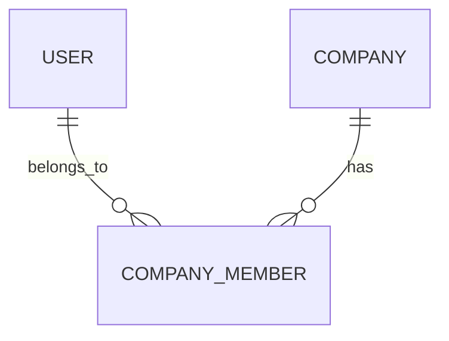

# Modelo de Dados: <Context>

## Diagrama ER (Mermaid)

## Tabelas

### `table_name`

| Coluna     | Tipo | Nullable | Default           | Constraints          | Descrição    |
| ---------- | ---- | -------- | ----------------- | -------------------- | ------------ |
| id         | text | N        | gen_random_uuid() | PK                   |              |
| company_id | text | N        |                   | FK → company.id, RLS | Tenant scope |
| ...        |      |          |                   |                      |              |

**Índices:** `CREATE INDEX ...`
**RLS Policies:** `policy_name` — `USING (company_id = get_tenant_id())`

## Migrações Relacionadas

- `drizzle/00XX_<name>.sql` — descrição
