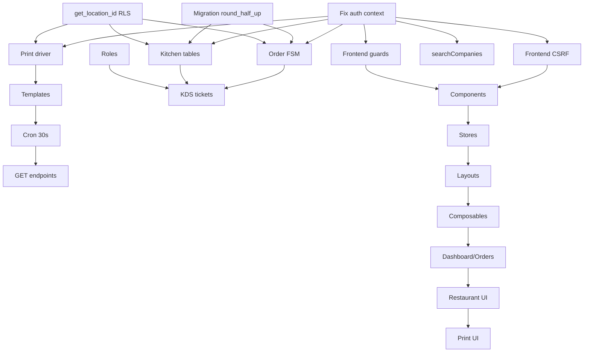

# Roadmap — Merp (Próximas Tarefas Priorizadas)

## Estado Atual por Bounded Context

| Contexto               | Previsto no Spec                                                                                                                  | Implementado | Evidência                                                                                                                          | Status      |
| ---------------------- | --------------------------------------------------------------------------------------------------------------------------------- | ------------ | ---------------------------------------------------------------------------------------------------------------------------------- | ----------- |
| **Auth**               | Login, Register, Session, Rate Limit, Lockout, Email Verify, Password Reset, Deactivate, Consent, Invites, Companies CRUD, Switch | **100%**     | 28 handlers + specs + tests                                                                                                        | ✅ Completo |
| **Company/Membership** | Create, Update, Delete (soft), Switch, Search, Members (add/remove), Roles (owner/member)                                         | **100%**     | 8 handlers + repository + RLS                                                                                                      | ✅ Completo |
| **Invites**            | Create (token 256-bit), Accept (atomic claim), List, TTL 7d, Legacy invalidation                                                  | **100%**     | 3 handlers + repository + migration                                                                                                | ✅ Completo |
| **Core Order**         | Order + Items + Dine-in/Takeout satellites, Idempotency, FSM (7 estados), RLS location, Snapshots                                 | **~40%**     | 4 handlers + repository; **FALTAM**: FSM estados `confirmed/preparing/ready`, transições validadas, `locationId` validation        | 🚧 Parcial  |
| **Restaurant Pack**    | Tables (open/close), Cashier Shifts (open/close/reconcile), Kitchen Tickets (KDS), Printers, Print Jobs                           | **~30%**     | 8 handlers + repository; **FALTAM**: `kitchen_station`/`kitchen_ticket` tables + RLS, role-based authz, KDS SSE, Print integration | 🚧 Parcial  |
| **Print/Operational**  | Print Jobs (queue, retry), Printers (register, default), Templates ESC/POS, Worker (30s retry)                                    | **~20%**     | Repository + task stub; **FALTAM**: `sendToPrinter` real, templates ESC/POS, GET endpoints, task 30s loop                          | 📋 Inicial  |
| **Frontend**           | Auth pages (5), Dashboard, Orders UI, Restaurant UI (Cashier/KDS/Tables), Print UI, Companies, Settings, i18n                     | **~5%**      | 5 auth pages apenas; **FALTAM**: Tudo pós-login, components, stores, layouts, guards                                               | 📋 Inicial  |

---

## Frontend Status: **PARCIAL**

**Resposta explícita**: Existe frontend Nuxt 4 em `app/` mas **apenas 5 páginas de autenticação** (login, register, forget-password, reset-password, verify-email).

**Evidência do que NÃO existe**:

- ❌ `app/pages/orders/` — 0 páginas (create, list, detail, kitchen view)
- ❌ `app/pages/restaurant/` — 0 páginas (tables map, cashier, KDS)
- ❌ `app/pages/print/` — 0 páginas (queue, printer config)
- ❌ `app/pages/companies/` — 0 páginas (list, create, settings, members)
- ❌ `app/components/` — 0 componentes reutilizáveis (Input, Button, Card, Table, Modal)
- ❌ `app/composables/` — 0 composables (`useApiFetch`, `useAuth`, `useCompany`, `useToast`)
- ❌ `app/stores/` — 0 Pinia stores (`auth`, `company`, `ui`, `orders`)
- ❌ `app/layouts/` — 0 layouts (`default.vue` com sidebar/header, `auth.vue` limpo)
- ❌ `app/middleware/` — 0 route guards (`auth.global.ts`, `guest.ts`)
- ❌ `i18n` — não configurado
- ❌ `@nuxt/ui` / `@pinia/nuxt` / `@vueuse/nuxt` — não instalados

**O que existe (auth pages)**: Bem estruturadas (TypeScript, loading/error states, accessibility, Tailwind), mas **sem CSRF token handling** → páginas pós-login falharão 403.

---

## Próximas Tarefas Priorizadas

### Fase 0: Desbloqueadores (P0 — Esta Semana)

| #       | Tarefa                                         | Objetivo                               | Por que agora                                  | Backend                                  | Frontend            | Esforço | Risco |
| ------- | ---------------------------------------------- | -------------------------------------- | ---------------------------------------------- | ---------------------------------------- | ------------------- | ------- | ----- |
| **T01** | Fix `event.context.auth` no middleware         | Desbloquear Order/Restaurant/Print     | **Quebra 15+ endpoints**                       | 1 linha em `auth.ts:153`                 | Nenhum              | **P**   | Baixo |
| **T02** | Migration `round_half_up` antes de 0014        | `db:migrate:full` passa em banco limpo | **CI/CD falha**                                | Mover função p/ `0013_round_half_up.sql` | Nenhum              | **P**   | Baixo |
| **T03** | Frontend `useApiFetch` + CSRF header           | Páginas pós-login funcionam            | **Sem isso, 403 em tudo**                      | Nenhum                                   | Composable + plugin | **P**   | Baixo |
| **T04** | Frontend auth route middleware                 | Proteger rotas privadas                | **UX/security**                                | Nenhum                                   | `auth.global.ts`    | **P**   | Baixo |
| **T05** | Criar `get_location_id()` + atualizar policies | RLS location-scoped                    | **Bloqueia Order/Restaurant/Print isolamento** | 1 migration + ~15 policy updates         | Nenhum              | **M**   | Médio |

### Fase 1: Core Order Completion (P1 — Próximas 2 Semanas)

| #       | Tarefa                                    | Objetivo                                             | Dependências | Backend                                          | Frontend                            | Esforço |
| ------- | ----------------------------------------- | ---------------------------------------------------- | ------------ | ------------------------------------------------ | ----------------------------------- | ------- |
| **T11** | Implementar FSM Order completo            | Estados `confirmed/preparing/ready` + transições 422 | T01, T05     | Repository methods + CHECK constraint + handlers | Order detail page com status badges | **M**   |
| **T12** | Validar `locationId` no create order      | Prevenir cross-location injection                    | T05          | Handler + repository check                       | Location selector no create form    | **P**   |
| **T13** | `searchCompanies` no MembershipRepository | Companies list endpoint                              | T01          | Repository method                                | Companies list page                 | **P**   |
| **T14** | Idempotency key via header (não body)     | Spec compliance                                      | T01          | Handler read header + validation                 | Header auto no `useApiFetch`        | **P**   |

### Fase 2: Restaurant Pack (P1 — Paralelo com Fase 1)

| #       | Tarefa                                                  | Objetivo                   | Dependências | Backend                     | Frontend                    | Esforço |
| ------- | ------------------------------------------------------- | -------------------------- | ------------ | --------------------------- | --------------------------- | ------- |
| **T21** | Criar `kitchen_station` + `kitchen_ticket` tables + RLS | KDS foundation             | T05          | Migration 0023 + grants     | Nenhum                      | **M**   |
| **T22** | Role-based authz (waiter/cashier/manager)               | Quem pode abrir mesa/turno | T01          | Handler checks ou DB policy | Role selector no user admin | **M**   |
| **T23** | Kitchen Ticket CRUD + status flow                       | KDS workflow               | T21          | Repository + handlers       | KDS page (SSE)              | **M**   |
| **T24** | Table map visual + open/close                           | Salon ops                  | T01          | Já existe repository        | Tables page (grid/map)      | **M**   |
| **T24** | Cashier shift reconcile UI                              | Fechamento de caixa        | T01          | Já existe repository        | Cashier page                | **P**   |

### Fase 3: Print MVP (P1 — Após T05)

| #       | Tarefa                                       | Objetivo            | Dependências | Backend                                                       | Frontend            | Esforço |
| ------- | -------------------------------------------- | ------------------- | ------------ | ------------------------------------------------------------- | ------------------- | ------- |
| **T31** | Implementar `sendToPrinter` (TCP/USB/Serial) | Impressão real      | T05          | Worker drivers + connectionConfig parsing                     | Nenhum              | **M**   |
| **T32** | Criar templates ESC/POS (2 arquivos)         | Content generation  | T31          | `restaurant-kitchen-ticket.ts`, `restaurant-table-comanda.ts` | Nenhum              | **M**   |
| **T33** | Task cron 30s loop (não 30min)               | Latência spec       | T31          | `setInterval` interno no task                                 | Nenhum              | **P**   |
| **T34** | GET `/jobs/:id` + GET `/jobs?status=queued`  | Frontend queue view | T01          | 2 handlers                                                    | Print queue page    | **P**   |
| **T35** | Validar `connectionConfig` JSON por type     | Segurança config    | T31          | Handler validation schema                                     | Printer config form | **P**   |

### Fase 4: Frontend Foundation (P1-P2 — 2-3 Semanas)

| #       | Tarefa                                                           | Objetivo                                                | Dependências | Frontend                             | Esforço |
| ------- | ---------------------------------------------------------------- | ------------------------------------------------------- | ------------ | ------------------------------------ | ------- |
| **T41** | Component library (`app/components/ui/`)                         | Input, Button, Card, Table, Modal, Select, Badge, Toast | T03          | Base components + Storybook opcional | **G**   |
| **T42** | Pinia stores (`auth`, `company`, `orders`, `ui`)                 | State management                                        | T03          | Stores + persistence (localStorage)  | **M**   |
| **T43** | Layouts (`default.vue`, `auth.vue`)                              | Shell app + sidebar/header                              | T03          | Layouts + navigation                 | **M**   |
| **T44** | Composables (`useApiFetch`, `useAuth`, `useCompany`, `useToast`) | Logic reuse                                             | T03, T42     | Composables                          | **M**   |
| **T45** | Pages: Dashboard, Companies, Orders List/Detail                  | Core UI                                                 | T41-T44      | Pages + routing                      | **G**   |
| **T46** | Pages: Restaurant (Tables, Cashier, KDS)                         | Restaurant ops                                          | T21-T24      | Pages + SSE para KDS                 | **G**   |
| **T47** | Pages: Print (Queue, Printers)                                   | Print ops                                               | T31-T34      | Pages                                | **M**   |

### Fase 5: Fiscal/NF-e + Hardening (P2 — Pós-MVP)

| #       | Tarefa                                          | Objetivo             | Dependências | Esforço |
| ------- | ----------------------------------------------- | -------------------- | ------------ | ------- |
| **T51** | NFC-e/DANFE integration (provider terceirizado) | Fiscal compliance    | T11, T21     | **G**   |
| **T52** | CSP header + `validate-env` CSRF_SECRET length  | Security hardening   | T03          | **P**   |
| **T53** | Serverless audit queue (auth_event persistence) | LGPD compliance      | T03-A03      | **M**   |
| **T54** | Schema/migration drift alignment                | Data integrity       | T02, T05     | **M**   |
| **T55** | i18n (pt-BR → multi-lang)                       | Internationalization | T41          | **M**   |

---

## Bloqueiros por Feature

| Feature                   | Bloqueadores (devem resolver antes)                           |
| ------------------------- | ------------------------------------------------------------- |
| **Core Order FSM**        | T01 (auth context), T05 (RLS location), T02 (migration order) |
| **Restaurant KDS**        | T01, T05, T21 (kitchen tables), T22 (roles)                   |
| **Print MVP**             | T01, T05, T31 (driver), T32 (templates)                       |
| **Frontend pós-login**    | T01, T03 (CSRF), T04 (guards)                                 |
| **Company list/search**   | T01, T13 (searchCompanies)                                    |
| **LGPD consent withdraw** | T01, T13 (revoke sessions)                                    |

---

## Quick Wins (≤ 1 hora cada)

1. **T01** — `event.context.auth` no middleware (1 linha)
2. **T02** — Migration `round_half_up` reorder (1 arquivo)
3. **T03** — Frontend `useApiFetch` com CSRF (1 composable)
4. **T04** — Frontend `auth.global.ts` middleware (1 arquivo)
5. **T13** — `searchCompanies` no repository (1 método)
6. **T14** — Idempotency key header (handler change)
7. **CSP header** — `nuxt.config.ts` routeRules (config)
8. **`validate-env` CSRF_SECRET length** — 1 check + test
9. **Task cron print 30s** — `setInterval` no task (5 linhas)
10. **GET print job endpoints** — 2 handlers simples

---

## Ordem Sugerida com Dependências

---

## Estimativa de Entrega

| Marco           | Prazo Estimado               | Entregáveis                                                                |
| --------------- | ---------------------------- | -------------------------------------------------------------------------- |
| **Semana 1**    | P0 fixes                     | Order/Restaurant/Print funcionando, Frontend auth flow OK                  |
| **Semana 2-3**  | Core Order + Restaurant base | FSM Order, Kitchen tables, Tables UI, Cashier UI                           |
| **Semana 4-5**  | Print MVP + KDS              | Impressão real, Templates, KDS SSE, Queue UI                               |
| **Semana 6-8**  | Frontend Foundation          | Component lib, Stores, Layouts, Dashboard, Orders, Restaurant, Print pages |
| **Semana 9-12** | Fiscal/NF-e + Hardening      | NFC-e, CSP, Audit queue, i18n, Schema alignment                            |

**Total estimado para MVP completo (Core + Restaurant + Print + Frontend básico): 8-12 semanas**
