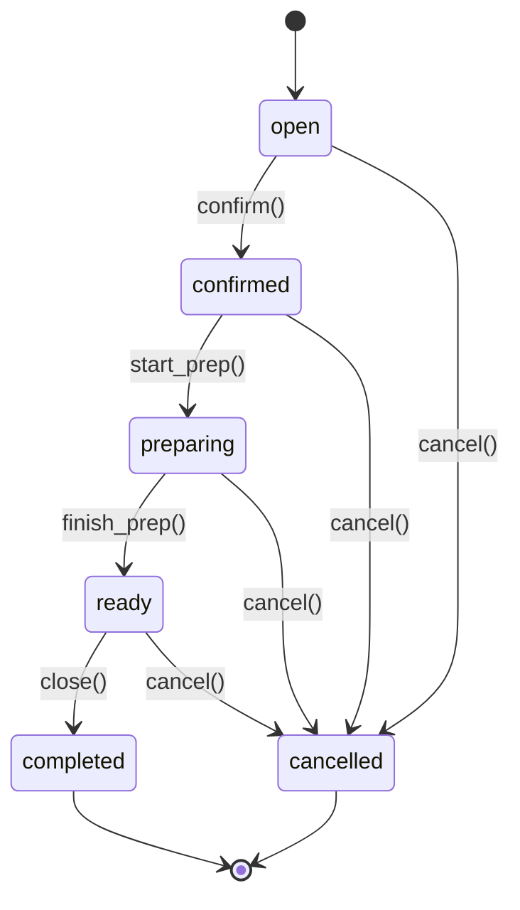

> **Estado (2026-10):** spec pronta, **implementação não iniciada**.
> Falta `plan.md`/`tasks.md`/`research.md`/`quickstart.md`.

# Feature Specification: Core Order (Núcleo Unificado)

**Status**: Spec pronta, implementação não iniciada

## Entidade `order`

### Campos Comuns (todas as ordens)

| Campo        | Tipo          | Constraints                                                                              |
| ------------ | ------------- | ---------------------------------------------------------------------------------------- |
| id           | uuid          | PK, default `gen_random_uuid()`                                                          |
| company_id   | uuid          | NOT NULL, FK → company.id                                                                |
| location_id  | uuid          | NOT NULL, FK → location.id                                                               |
| order_type   | text          | NOT NULL, CHECK IN ('dine_in','takeout','delivery','retail_pos','wholesale','quotation') |
| status       | text          | NOT NULL, DEFAULT 'open' — FSM por order_type                                            |
| customer_id  | uuid          | NULLABLE, FK → party.id                                                                  |
| party_id     | uuid          | NULLABLE, FK → party.id (cliente ou fornecedor)                                          |
| total_amount | numeric(12,2) | NOT NULL, DEFAULT 0 — soma das linhas (servidor)                                         |
| currency     | text          | NOT NULL, DEFAULT 'BRL'                                                                  |
| notes        | text          | NULLABLE                                                                                 |
| created_by   | uuid          | NOT NULL, FK → user.id                                                                   |
| created_at   | timestamptz   | NOT NULL, DEFAULT now()                                                                  |
| updated_at   | timestamptz   | NOT NULL, DEFAULT now()                                                                  |
| closed_at    | timestamptz   | NULLABLE                                                                                 |

### Satélites por `order_type`

| order_type | Tabela Satélite  | Campos Extra                                  |
| ---------- | ---------------- | --------------------------------------------- |
| dine_in    | order_dine_in    | table_id, cover_count, waiter_id, opened_at   |
| takeout    | order_takeout    | pickup_at, pickup_name, pickup_phone          |
| delivery   | order_delivery   | address_id, delivery_fee, courier_id, eta     |
| retail_pos | order_retail_pos | register_id, cashier_id, payment_method       |
| wholesale  | order_wholesale  | po_number, payment_terms, shipping_address_id |
| quotation  | order_quotation  | valid_until, approved_by, approved_at         |

### FSM por `order_type` (Mermaid)

**Transições inválidas = 422** com `{ "error": "invalid_transition", "message": "Cannot transition from X to Y", "details": { "current": "X", "target": "Y" } }`.

### RLS

- `company_id` + `location_id` obrigatórios (ver `specs/000-foundation/rls-pattern.md`)
- Policy: `company_id = get_tenant_id() AND (location_id = get_location_id() OR get_location_id() IS NULL)`

### Idempotency

Criação de `order` **exige** header `Idempotency-Key` (ver `specs/000-foundation/idempotency.md`).

---

## Tabela `order_item`

| Campo            | Tipo          | Constraints                                                   |
| ---------------- | ------------- | ------------------------------------------------------------- |
| id               | uuid          | PK                                                            |
| order_id         | uuid          | NOT NULL, FK → order.id                                       |
| product_id       | uuid          | NULLABLE, FK → product.id                                     |
| product_name     | text          | NOT NULL — snapshot                                           |
| unit_price       | numeric(12,2) | NOT NULL — snapshot                                           |
| quantity         | numeric(12,3) | NOT NULL                                                      |
| tax_snapshot     | jsonb         | NOT NULL — alíquota vigente                                   |
| bom_snapshot     | jsonb         | NULLABLE — ficha técnica                                      |
| discount_applied | numeric(12,2) | DEFAULT 0 — snapshot                                          |
| line_total       | numeric(12,2) | GENERATED ALWAYS AS (round(unit_price \* quantity, 2)) STORED |
| sort_order       | integer       | DEFAULT 0                                                     |
| created_at       | timestamptz   | DEFAULT now()                                                 |

**Snapshot rule** (ver `specs/000-foundation/snapshot.md`): editar produto não reescreve o passado.

---

Ver também: `specs/007-print/` (impressão operacional).
