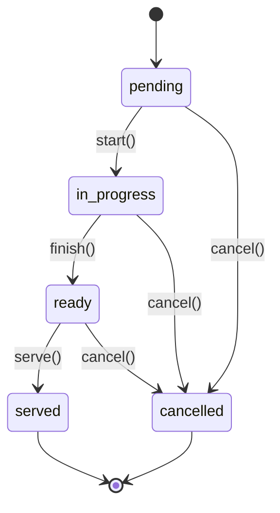

# Feature Specification: Restaurant Pack

**Status**: Spec pronta, implementação não iniciada

## Entidades

### restaurant_table (Mesa/Comanda)

| Campo            | Tipo        | Constraints                                                   |
| ---------------- | ----------- | ------------------------------------------------------------- |
| id               | uuid        | PK                                                            |
| company_id       | uuid        | NOT NULL, FK → company.id                                     |
| location_id      | uuid        | NOT NULL, FK → location.id                                    |
| number           | integer     | NOT NULL — número da mesa                                     |
| name             | text        | NULLABLE — ex.: "Varanda", "Salão"                            |
| capacity         | integer     | DEFAULT 4                                                     |
| status           | text        | NOT NULL, DEFAULT 'free' — free, occupied, reserved, cleaning |
| current_order_id | uuid        | NULLABLE, FK → order.id                                       |
| created_at       | timestamptz | DEFAULT now()                                                 |
| updated_at       | timestamptz | DEFAULT now()                                                 |

**Unique**: (company_id, location_id, number)

### kitchen_ticket (KDS)

| Campo         | Tipo        | Constraints                                                                  |
| ------------- | ----------- | ---------------------------------------------------------------------------- |
| id            | uuid        | PK                                                                           |
| company_id    | uuid        | NOT NULL                                                                     |
| location_id   | uuid        | NOT NULL                                                                     |
| order_id      | uuid        | NOT NULL, FK → order.id                                                      |
| order_item_id | uuid        | NOT NULL, FK → order_item.id                                                 |
| station_id    | uuid        | NOT NULL, FK → kitchen_station.id — grill, fryer, salad, bar                 |
| status        | text        | NOT NULL, DEFAULT 'pending' — pending, in_progress, ready, served, cancelled |
| priority      | integer     | DEFAULT 0 — maior = mais urgente                                             |
| started_at    | timestamptz | NULLABLE                                                                     |
| ready_at      | timestamptz | NULLABLE                                                                     |
| served_at     | timestamptz | NULLABLE                                                                     |
| created_at    | timestamptz | DEFAULT now()                                                                |
| updated_at    | timestamptz | DEFAULT now()                                                                |

### kitchen_station

| Campo         | Tipo    | Constraints                                             |
| ------------- | ------- | ------------------------------------------------------- |
| id            | uuid    | PK                                                      |
| company_id    | uuid    | NOT NULL                                                |
| location_id   | uuid    | NOT NULL                                                |
| name          | text    | NOT NULL — ex.: "Grill", "Fritadeira", "Saladas", "Bar" |
| display_order | integer | DEFAULT 0                                               |
| is_active     | boolean | DEFAULT true                                            |

### printer

| Campo       | Tipo        | Constraints                                                          |
| ----------- | ----------- | -------------------------------------------------------------------- |
| id          | uuid        | PK                                                                   |
| company_id  | uuid        | NOT NULL                                                             |
| location_id | uuid        | NOT NULL                                                             |
| name        | text        | NOT NULL                                                             |
| driver      | text        | NOT NULL — escpos, star, epson, custom                               |
| connection  | jsonb       | NOT NULL — {type: 'network'/'usb'/'bluetooth', host, port, mac, ...} |
| station_ids | uuid[]      | NOT NULL — quais estações imprimem aqui                              |
| is_active   | boolean     | DEFAULT true                                                         |
| created_at  | timestamptz | DEFAULT now()                                                        |

### print_job

| Campo             | Tipo        | Constraints                                                    |
| ----------------- | ----------- | -------------------------------------------------------------- |
| id                | uuid        | PK                                                             |
| company_id        | uuid        | NOT NULL                                                       |
| location_id       | uuid        | NOT NULL                                                       |
| printer_id        | uuid        | NOT NULL, FK → printer.id                                      |
| kitchen_ticket_id | uuid        | NULLABLE, FK → kitchen_ticket.id                               |
| content           | text        | NOT NULL — ESC/POS bruto ou template renderizado               |
| status            | text        | NOT NULL, DEFAULT 'queued' — queued, printing, printed, failed |
| attempts          | integer     | DEFAULT 0                                                      |
| printed_at        | timestamptz | NULLABLE                                                       |
| created_at        | timestamptz | DEFAULT now()                                                  |

### cashier_shift (Turno de Caixa)

| Campo         | Tipo          | Constraints                                              |
| ------------- | ------------- | -------------------------------------------------------- |
| id            | uuid          | PK                                                       |
| company_id    | uuid          | NOT NULL                                                 |
| location_id   | uuid          | NOT NULL                                                 |
| user_id       | uuid          | NOT NULL, FK → user.id                                   |
| register_id   | uuid          | NULLABLE, FK → pos_register.id                           |
| opened_at     | timestamptz   | NOT NULL, DEFAULT now()                                  |
| closed_at     | timestamptz   | NULLABLE                                                 |
| opening_float | numeric(12,2) | NOT NULL — fundo de caixa inicial                        |
| expected_cash | numeric(12,2) | NULLABLE — calculado no fechamento                       |
| actual_cash   | numeric(12,2) | NULLABLE — contado pelo operador                         |
| difference    | numeric(12,2) | GENERATED ALWAYS AS (actual_cash - expected_cash) STORED |
| status        | text          | NOT NULL, DEFAULT 'open' — open, closed, discrepancy     |
| notes         | text          | NULLABLE                                                 |

## Fluxo Principal

1. **Abrir mesa** → `POST /api/v1/restaurant/tables/:id/open` (cria order dine_in, vincula table)
2. **Lançar item** → `POST /api/v1/orders` (order_type=dine_in, items...)
3. **KDS recebe** → kitchen_ticket criado por trigger/evento, status=pending
4. **Item pronto** → `PATCH /api/v1/restaurant/kitchen-tickets/:id/status` (status=ready)
5. **Fechar conta** → `PATCH /api/v1/orders/:id/status` (status=completed) + pagamento
6. **Pagamento** → NFC-e (fase posterior)

## FSM kitchen_ticket

**Transições inválidas = 422**.

## RLS

Todas as tabelas: `company_id` + `location_id` obrigatórios (ver ADR-002).
Policy padrão: `company_id = get_tenant_id() AND (location_id = get_location_id() OR get_location_id() IS NULL)`.
